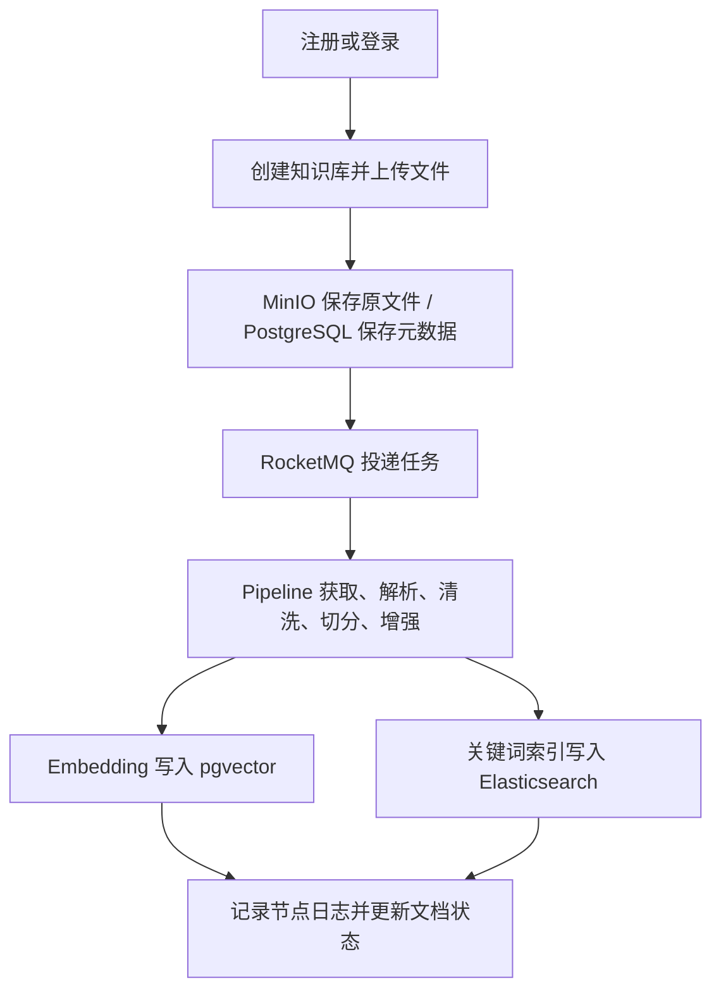
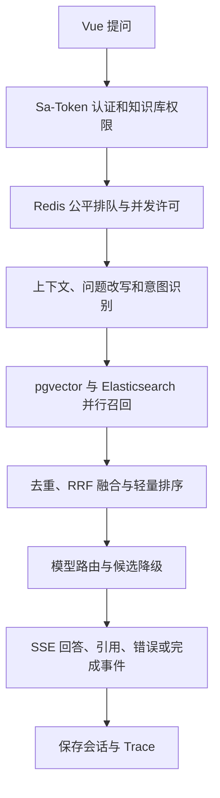

# IntelHub

IntelHub 是一个面向演示与学习的 RAG 知识问答系统，参考 `D:\project\ragent` 的业务边界重新实现：前端采用 Vue 3，后端采用 Java/Spring Boot。当前仓库已覆盖从注册、知识库和文档入库到混合检索、流式问答、引用与 Trace 的主要路径。

项目背景、架构图、技术取舍和 20 周排期见 [开发计划](docs/development-plan.md)。

## 背景与解决的问题

组织知识散落在 PDF、Word、Markdown 和文本文件中，人工检索慢，单一向量召回又容易漏掉编号、关键词和专有名词。没有来源引用的生成式回答难以核验；同步入库不利于跟踪失败；单模型故障会中断服务；多用户争用模型并发时也容易让请求互相挤占。

IntelHub 把文档解析、清洗、切分、元数据增强和索引组织为 Pipeline；以 pgvector 和 Elasticsearch 并行召回，再通过 RRF 与轻量重排融合；问答以 SSE 返回阶段和内容，并保存来源和 Trace。Redis 公平队列、模型候选切换/熔断和 RocketMQ 异步入库用于展示可扩展的工程模式。

## 技术栈与架构取舍

| 部分 | 技术 | 取舍 |
|---|---|---|
| Web | Vue 3、TypeScript、Vite、Pinia、Vue Router、Element Plus | Vue 重建参考业务页面；浏览器用 fetch 消费 POST SSE。 |
| 服务端 | Java 17、Spring Boot 3.5、Maven 多模块、Sa-Token、Flyway | 模块化单体保留业务边界，方便单人开发和本地部署。 |
| 关系与向量 | PostgreSQL 17、pgvector | 业务数据与作品集规模向量同库维护；不引入独立向量服务，降低演示部署成本。 |
| 关键词检索 | Elasticsearch 8 + IK | 中文 BM25 检索补充关键词、编号和专名召回。IK 插件镜像无法构建时，应用会回退到 Elasticsearch 标准分词。 |
| 队列与缓存 | Redis 7、RocketMQ 5 | Redis 管理分布式排队、许可和熔断共享状态；RocketMQ 异步执行文档入库。 |
| 文件与解析 | MinIO、AWS S3 SDK、Apache Tika、CommonMark | 原始文件对象存储，PDF/DOCX/TXT 由 Tika 解析，Markdown 使用 CommonMark。 |
| AI | OpenAI-compatible Chat / Embedding 接口、MCP Java SDK | API 地址、密钥和模型名从环境变量注入；外部模型可选。 |

整体采用模块化单体，Maven 模块为 `framework`、`infra-ai`、`bootstrap` 和独立演示用 `mcp-server`。入库采用 RocketMQ 异步任务；问答查询通过 Redis 公平许可控制后并行检索。pgvector + Elasticsearch 对作品集部署更轻量，代价是超大规模向量检索与独立扩缩能力弱于专用向量数据库。Rerank 可配置 Cohere-compatible `/rerank` 接口；未配置或调用失败时保留 RRF 与词面排序。

## 主要交互链路

### 文档入库



### 智能问答



## 目录结构

```text
backend/
  framework/       通用响应
  infra-ai/        Chat 与 Embedding 适配、模型路由
  bootstrap/       API、认证、知识库、入库、RAG、管理、迁移
  mcp-server/      演示 MCP 服务和工具
frontend/          Vue 3 单页应用
infra/             Elasticsearch 与 RocketMQ 配置
docker-compose.yml 本地依赖、双后端和前端入口
```

## 本地启动

需要 Docker Desktop / Docker Compose。可选配置外部模型；不配置时，系统使用本地演示 Embedding 和基于检索证据的保守回答。首次启动会拉取并构建镜像，ES IK 插件和 Maven 依赖需要网络。

```powershell
Copy-Item .env.example .env
# 按需编辑 .env，设置外部模型及管理员引导账户
docker compose up --build
```

打开 `http://localhost:8080`。管理员账户仅在 `.env` 配置 `INTELHUB_ADMIN_USERNAME` 和 `INTELHUB_ADMIN_PASSWORD` 后由启动器创建；未配置时没有固定演示账户，可自行注册普通用户。MinIO 控制台在 `http://localhost:19001`。关闭服务使用 `docker compose down`；清空所有演示数据时使用 `docker compose down -v`。

本地开发可分别运行后端和前端（基础设施仍由 Compose 启动）：

```powershell
docker compose up -d postgres redis elasticsearch minio namesrv broker mcp-server
# Maven Wrapper 优先使用 JAVA_HOME；若它指向旧 JDK，可按 PATH 上的 Java 校正当前终端：
$javaExe = (Get-Command java -ErrorAction Stop).Source
$env:JAVA_HOME = Split-Path (Split-Path $javaExe -Parent) -Parent
& "$env:JAVA_HOME\bin\java.exe" -version # 确认主版本为 17 或更高
$env:MAVEN_USER_HOME = "$PWD\.maven-cache"
./mvnw.cmd -DskipTests -pl backend/bootstrap -am package
java -jar .\backend\bootstrap\target\intelhub-bootstrap-0.1.0-SNAPSHOT.jar
```

```powershell
cd frontend
npm install
npm run dev
```

## 已提供能力

- 注册、登录、退出、当前用户；BCrypt 密码；普通用户只访问自己的知识库，管理员可以管理用户。
- 知识库 CRUD、PDF/DOCX/Markdown/TXT 上传、MinIO 文件存储、文档状态。
- 可配置 Pipeline 节点顺序、RocketMQ 异步执行、幂等锁、节点日志和失败重试入口。
- pgvector 与 Elasticsearch 并行检索，RRF 融合、去重、引用来源；无证据时返回保守提示。
- POST SSE 问答、会话历史、简化问题改写和意图识别、MCP 演示工具、Trace 查询。
- 助手回答有帮助/没帮助反馈；管理员可运行固定的检索评测集并查看 Hit@1、Recall@6、MRR 和证据词覆盖率。
- 主/候选模型路由、Redis 共享熔断状态、半开探测；Redis ZSET FIFO 排队、租期许可、每用户请求限额。
- 管理面板：用户、模型健康、意图、MCP 工具、运行概览、Trace 和并发许可设置。
- Compose 运行两个后端实例，便于本地观察 Redis 共享状态和公平队列。

## 主要 API

- `POST /api/auth/register|login|logout`、`GET /api/auth/me`
- `/api/knowledge-bases`、`/api/documents`、`/api/ingestion-pipelines`
- `POST /api/chat/stream`（SSE）和 `/api/conversations`
- `/api/admin/users`、`/api/admin/models`、`/api/admin/settings`、`/api/admin/traces`、`/api/admin/intents`
- `POST /api/conversations/messages/{messageId}/feedback`、`GET /api/admin/evaluation/cases`、`POST /api/admin/evaluation/run`

## 演示交付物

- [系统架构图](docs/architecture.md)：Compose 部署拓扑、文档入库和问答时序。
- [本地演示与配置指南](docs/demo-guide.md)：环境变量、启动、排障和逐项验收说明。
- [问答反馈与离线评测](docs/rag-feedback-evaluation.md)：反馈接口、安全范围、评测指标和运行方式。
- [演示示例文档](demo-data/employee-leave-policy.md)：可直接上传的虚构 Markdown 资料。
- [端到端演示脚本](scripts/demo.ps1)：注册或登录、创建知识库、上传、等待入库、POST SSE 问答并读取 Trace。

## 当前演示边界

此版本面向作品集和本地演示，不承诺生产 SLA、组织级多租户或复杂 OCR。无外部 Embedding 配置时的哈希向量仅用于本地演示，中文检索质量有限；无 Chat 模型密钥时返回检索证据摘要式回答。MCP 工具是确定性的模拟数据。上线前还需要补充结构化配置校验、审计与指标体系、数据清理策略和端到端安全评估。
