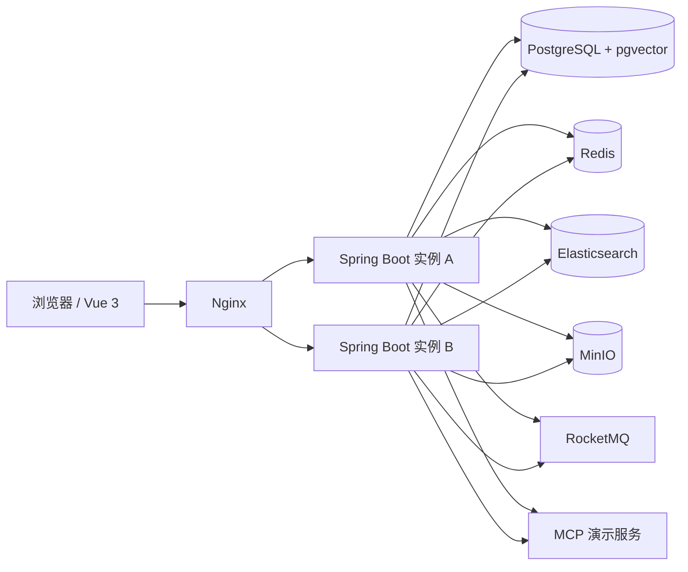
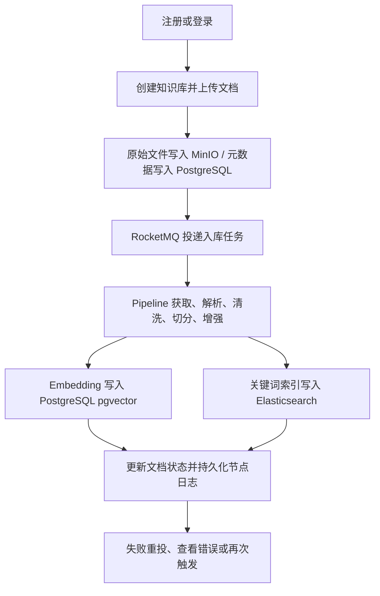
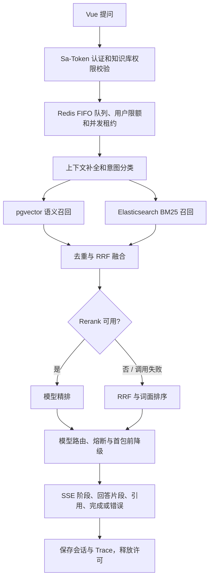

# IntelHub RAG 系统开发计划

## 开发背景

IntelHub 面向面试演示，目标是展示从账号注册、文档入库到可追溯智能问答的完整 RAG 工程链路。业务能力参考 `D:\project\ragent`，前端改用 Vue 3 重建，后端保持 Java 技术路线。

### 解决的真实痛点

- 企业制度、产品资料、工单文档分散在 PDF、Word、Markdown 和文本文件中，人工定位信息慢。
- 单一向量召回容易漏掉编号、精确术语和关键词；没有可靠出处的回答难核验。
- 文档解析、清洗、切分和索引缺少统一的可观测流程，失败后难定位和重试。
- 单个模型服务超时或不可用时，问答链路容易整体中断。
- 多用户共用模型并发额度时，缺少公平排队、用户限额与跨实例许可管理。
- 检索命中、模型选择、失败阶段和耗时不可见，管理员难以排查问答质量。

## 技术栈

| 层次 | 选型 | 使用范围 |
|---|---|---|
| 前端 | Vue 3、TypeScript、Vite、Pinia、Vue Router、Element Plus | 登录注册、问答、知识库、Pipeline 和管理工作台；用 fetch 消费 POST SSE。 |
| 后端 | Java 17、Spring Boot 3.5、Maven 多模块、MyBatis-Plus、Sa-Token、Flyway | 认证、权限、领域 API、SQL 访问和版本化迁移。 |
| 账号安全 | BCrypt、环境变量管理员引导 | 开放自助注册；新用户默认为普通用户，管理员显式引导创建。 |
| 业务与向量存储 | PostgreSQL 17、pgvector | 用户、知识库、文档、会话、追踪、Pipeline、文本片段与 Embedding。 |
| 关键词检索 | Elasticsearch 8、IK | 中文 BM25 召回；IK 不可用时创建标准分词索引。 |
| 共享状态与公平排队 | Redis 7、Lua、ZSET、Pub/Sub | FIFO 等待队列、并发租约、每用户限额、模型熔断器共享状态和配置。 |
| 异步任务 | RocketMQ 5 | 文档入库、重试投递和消费者扩展。 |
| 文件和解析 | MinIO、AWS S3 SDK、Apache Tika、CommonMark | 原文件存储；PDF、DOC/DOCX、TXT、Markdown 解析。 |
| 模型与工具 | OpenAI-compatible Chat/Embedding、Cohere-compatible Rerank、MCP SDK | 主备 Chat 路由、Embedding、可选 Rerank 和演示业务工具。 |
| 本地部署 | Docker Compose、Nginx | PostgreSQL、Redis、ES、MinIO、RocketMQ、MCP、双后端和 Vue 前端。 |

## 技术架构与取舍

采用模块化单体，Maven 模块按 `framework`、`infra-ai`、`bootstrap` 和 `mcp-server` 划分。后端在 Compose 中运行两个实例，以验证 Redis 共享状态；RocketMQ 将耗时文档入库从上传 API 中解耦。

| 决策 | 选择与理由 | 代价 |
|---|---|---|
| 应用拆分 | 模块化单体，单人开发可本地运行，同时保留清晰模块边界。 | 高负载时需要按模块独立伸缩，当前不能单独扩缩某项业务。 |
| 向量检索 | PostgreSQL + pgvector 与业务数据同库，适合演示规模且运维简单。 | 超大规模向量查询的扩展性不及专用向量服务。 |
| 混合召回 | 向量与 ES 并行召回，按 chunk 去重后 RRF 融合。 | 需要维护两套索引，并处理索引一致性。 |
| 精排 | 可选 Cohere-compatible Rerank HTTP 接口；未配置或出错时用 RRF + 词面排序。 | 不同厂商仍需适配请求字段、鉴权和结果格式。 |
| 模型容错 | Chat 主模型、候选模型、Redis 共享熔断状态、半开探测；首包前失败才切换，避免拼接两个答案。 | 供应商协议差异由应用适配层负责。 |
| 公平并发 | Redis 原子脚本为 FIFO 队列分配带租期并发许可；用户独立限额。 | Redis 故障时问答请求不能获得许可，未承诺生产 SLA。 |
| 入库重试 | RocketMQ 消费失败后重投，Redis 锁避免重复并行处理；每节点持久化执行记录。 | 数据库和 ES 跨系统写入需要通过幂等重试收敛。 |
| 账号引导 | 开放注册；管理员只从环境变量引导，不固化演示密码。 | 部署人需在启动前配置管理员账户。 |

## 系统交互流程

### 总体部署关系

### 文档入库

### 智能问答

SSE 事件包括 `status`、`intent`/`clarification`、`citations`、`token`、`done` 和 `error`。连接超时或客户端断开时取消模型输出并释放队列租约。

## 模块划分

| 模块 | 后端边界 | 前端页面/责任 |
|---|---|---|
| 身份与授权 | 注册、登录、退出、当前用户、BCrypt、普通用户隔离、管理员引导 | 登录注册表单、Pinia 用户状态、路由守卫。 |
| 知识库和文档 | CRUD、文件校验、MinIO、归属校验、文档状态 | 知识库管理、上传、索引状态与删除。 |
| Pipeline | 节点注册、顺序配置、RocketMQ、运行和节点日志、幂等锁 | Pipeline 配置、节点重排、执行记录。 |
| RAG | 会话、上下文、意图、多路检索、融合、引用、SSE、Trace | 流式聊天、会话选择、来源引用和阶段提示。 |
| AI 基础设施 | Chat、Embedding、Rerank 供应商接口、路由、熔断和降级 | 管理模型状态与 Rerank 配置状态；密钥不回传。 |
| 公平并发 | Redis 队列、限额、租期许可、Pub/Sub 唤醒 | 排队阶段与管理员并发设置。 |
| MCP 工具 | 工具发现、调用客户端、示例服务和模拟数据 | 显示已连接工具；问答按触发词调用演示工具。 |
| 管理和运维 | 用户、意图、系统概览、模型状态、设置、Trace | 管理台各视图与问答质量诊断。 |

## 20 周开发周期计划

按 1 人全职估算，前后端按垂直功能逐步联调。

| 周期 | 模块 | 工作内容与阶段交付 |
|---|---|---|
| 第 1 周 | 工程基础 | Maven 多模块、Vue 3 工程、统一 API 响应、Flyway 迁移、Compose 服务骨架。 |
| 第 2–3 周 | 账号与用户 | 注册、登录、登出、当前用户、角色、BCrypt、管理员引导；登录注册页与路由守卫。 |
| 第 4–5 周 | 知识库与文档 | CRUD、归属隔离、上传、MinIO、状态页、文档列表。**已完成验收**：运行态验证创建/编辑/删除、跨用户隔离、TXT 上传入库状态和资源清理。 |
| 第 6–8 周 | 入库 Pipeline | 解析、规范化、切分、元数据、Embedding 与索引节点；RocketMQ 异步、幂等、日志、失败重试和管理页。**已完成验收**：节点可编排、迁移与异步运行通过；真实 `.doc` 完整入库，失败状态重试后重新完成。 |
| 第 9–11 周 | RAG 检索和问答 | pgvector + ES 并行召回、RRF、Rerank 与回退、引用、保守回答、POST SSE、Trace 和聊天页。**已完成验收**：检索故障单路降级、RRF/Rerank 回退、无证据回答、流式引用与 Trace 均已自动化和运行态验证。 |
| 第 12–13 周 | 模型路由与熔断 | Chat/Embedding/Rerank 适配、主备优先级、健康状态、熔断、半开和首包前降级；模型状态页。**已完成验收**：自动化覆盖主备路由、断路器阈值、半开单探测、首包前降级及中断流识别；Compose 模拟主模型故障、备用回答和主模型恢复，管理页与状态 API 可读。 |
| 第 14–15 周 | 会话与意图 | 历史、滚动摘要记忆、追问改写、意图分类与交互式澄清、会话和意图管理。**已完成验收**：自动化与 Compose 均验证记忆、追问改写、澄清暂停/恢复和 Trace。 |
| 第 16 周 | MCP 工具 | 工具发现和调用协议、1–2 个模拟工具、工具结果进入回答上下文。**已完成验收**：Streamable HTTP 协议集成测试确认发现两个工具并成功调用；RAG 测试确认无知识库证据时工具结果进入模型提示词并写入 Trace。 |
| 第 17–18 周 | 限流与管理运维 | Redis ZSET + Lua FIFO、并发租期、用户限额、超时与断开释放；仪表盘、Trace、设置、用户管理。**已完成验收（自动化与本地真实 Redis 验证）**：跨两个 Limiter 实例验证 FIFO、并发许可和租期回收；覆盖配额、超时、取消清票、流式断开释放；管理 API 权限、仪表盘/设置、Trace 隔离测试通过。Docker Engine 当前拒绝本机连接，Compose 整栈运行态未复验。 |
| 第 19 周 | 集成与安全 | 端到端联调、权限隔离、重复任务、SSE 断流、索引一致性和降级路径修复。**自动化与跨模块验收通过（外部依赖使用测试替身）**：上传→六节点入库→双路召回→带引用回答/Trace 的联调测试通过；重复投递、真实 HTTP SSE 断开、索引故障重试收敛和权限隔离覆盖通过。Compose 整栈运行态因本机 Docker Engine 命名管道拒绝连接未复验。 |
| 第 20 周 | 验收与演示 | **本地验收通过**：双实例 Compose、配置与启动指南、架构图、示例数据、PowerShell 端到端演示脚本和交付清单均已提供；两后端及依赖服务健康，注册到入库、SSE 引用回答和 Trace 的运行演示通过。交付入口见 README。外部 Chat 未配置时使用 `local-demo`，不代表真实供应商质量验收。 |

### 第 20 周验收与演示交付记录

- 演示与配置指南 docs/demo-guide.md 覆盖 PowerShell 7 / Docker Compose 前置条件、环境变量、双实例启动、端口、健康检查、模型配置、常见故障和交付验收清单；README 链接到该指南。真实密钥仍由操作者写入未纳入版本控制的 .env。
- 架构文档 docs/architecture.md 提供 Compose 部署视图、文档入库与问答时序图、模块依赖及选型边界。
- demo-data/employee-leave-policy.md 提供内容明确标注为虚构的 Markdown 样本，适合直接上传；scripts/demo.ps1 引导注册/登录、创建知识库、上传样本、等待入库、调用 POST SSE 并查询 Trace。
- 运行态验收：2026-10-05 在独立 Compose 项目 `intelhub-clean-volume-20261005` 使用全新命名卷启动；PostgreSQL 空 schema 自动执行 Flyway V1–V4，两个后端、前端、PostgreSQL、Redis、Elasticsearch、MinIO、RocketMQ、MCP 服务均健康，首页/readiness 返回 200。`scripts/demo.ps1` 在该空卷环境完成账号注册/登录、知识库创建、样例上传和 POST SSE 问答；文档为 `COMPLETED` 且含 1 个分块，SSE 返回非空回答 token、1 条引用和完成事件，Trace 为 `COMPLETED`，向量/关键词各命中 1 条。Chat 使用 `local-demo`，外部模型质量未验收。由于本机对 Quay 返回 401、Docker Hub manifest 请求 EOF，本次运行显式覆盖 `MINIO_IMAGE` 使用本机缓存的 `interviewmirror/minio-local:RELEASE.2025-10-15T17-29-55Z`；模板默认已改为版本固定的 `alpine/minio` 社区重建镜像，但该新来源未能在本机网络中拉取验证。临时演示项目及其专属卷在验收后清理，原 `intelhub` 项目未触碰。

## 验收清单

### 知识库与文档模块验收记录

- 后端覆盖知识库编辑、越权拒绝、删除前清理 Elasticsearch/MinIO、外部清理失败时保留数据库记录供重试；单文档删除也会清理检索索引和原文件。
- 前端知识库页面支持编辑、文档状态查看和轮询刷新；删除提示说明会同时移除文档和索引。
- 自动化验收：Maven 全模块共 25 项测试通过；前端路由策略测试 7 项通过，生产构建成功。RocketMQ 消息发送等待时间可配置，默认 10 秒；投递失败只在文档仍处于排队状态时标记失败；文档已删除的过期队列消息会被确认并丢弃，Redis 幂等锁通过原子 compare-and-delete 释放，避免无限重试和误删并发任务的锁。ParserNode 的回归测试使用真实 OLE/Word 97–2003 `.doc` fixture。
- Compose 运行态验收：临时双用户验证知识库创建/编辑/列表回读和归属隔离；TXT、Markdown、PDF、DOCX 和真实二进制 Word 97–2003 `.doc` 均从队列处理到 `COMPLETED` 并生成分块；验证单文档删除、知识库级删除和跨用户文档查询拒绝。`.doc` 样本的 Pipeline 节点 `parse`、`normalize`、`chunk`、`metadata`、`embedding`、`index` 全部完成；临时账号、知识库和文档均已清理。

### 入库 Pipeline 模块验收记录

- 节点拆分为 `parse`、`normalize`、`chunk`、`metadata`、`embedding`、`index`；Embedding 独立计算每个文本块的向量，索引节点将向量写入 pgvector、文本写入 Elasticsearch。`normalize` 与 `metadata` 可选；编排校验要求 parse 首位、index 末位，且 chunk 在 embedding 前。
- Flyway V2 将既有流程自动补入 embedding 步骤，V3 修正新建流程的数据库默认节点。Compose 双后端启动并迁移到 schema v3；数据库默认节点已确认包含 `parse → chunk → embedding → index`。
- RocketMQ 消费异常会记录文档、运行和节点失败状态后抛回消息代理；Redis 幂等锁使用租期和原子 compare-and-delete。过期文档消息会被确认并丢弃；失败文档可由知识库页调用重试接口重新入队。
- Pipeline 页面支持新建/删除流程、编辑名称、添加/移除可选节点、重排节点及查看最近运行和节点耗时；服务端同步校验执行顺序。知识库页面提供失败文档重试。
- 自动化验收：Maven 全模块 36 项测试通过（bootstrap 34 项、infra-ai 2 项），其中覆盖真实旧版 `.doc` 解析、独立 Embedding/索引、Pipeline 节点顺序校验、消费失败记录、重试入队，以及 OpenAI-compatible Embedding 请求和 503 回退；前端 7 项路由策略测试和生产构建通过。
- Compose 运行态验收：Flyway 从 schema v1 升级到 v3，默认流程包含全部六个节点。使用真实二进制 `.doc` 完整执行 `parse → normalize → chunk → metadata → embedding → index`，文档状态为 `COMPLETED`、生成 1 个分块且六个节点均完成；另验证自定义流程的可选节点增删、重排和保存，以及不含可选节点的 `parse → chunk → embedding → index` 流程。将临时 QA 文档置为失败状态后调用重试接口，第二次运行重新完成，全部节点为 `COMPLETED`；临时账号、知识库、流程和文档已清理。
- 外部 Embedding 使用本地 OpenAI-compatible HTTP 测试端点验证请求格式、模型名、维度、鉴权和向量解析，并验证服务不可用时稳定回退。当前 Compose 未配置真实外部模型凭据，默认使用本地确定性 Embedding。
- 真实 RocketMQ 自动重投运行态验收：将临时文档置为 `FAILED` 并暂时把对象键改为不存在对象，经重试接口投递后，`parse` 节点消费失败并记录失败状态；恢复原对象键后未再手工触发重试，运行记录可见消费失败及后续成功投递，由 RocketMQ 自动重投完成六节点流程。最终文档状态为 `COMPLETED`、生成 1 个分块；临时账号、知识库、文档及对象均已清理。

### RAG 检索与问答模块验收记录

- 向量检索（pgvector）和 Elasticsearch 关键词检索由独立线程池并行执行。任一路异常时继续使用另一路的召回结果；两路同时异常时通过 SSE 返回检索服务错误，不会伪装成“没有证据”。Trace 记录两路可用状态、命中数、融合引用数和失败类型。
- RRF 按 chunk 去重并融合两路排名；配置 Rerank 时采用重排顺序，未配置或调用异常时保留 RRF 与词项重合度排序。自动化用例覆盖融合去重、并行执行、重排成功和异常回退，以及两种单路降级和双路不可用。
- 没有任何有效召回资料且没有 MCP 结果时返回固定的无证据答复；向量近邻仍会按可配置的最低相似度过滤，关键词结果按词项重合度过滤，避免无关近邻被当成证据。默认阈值为向量相似度 `0.25`、词项重合度 `0.1`，可通过 `RAG_MIN_VECTOR_SIMILARITY` 和 `RAG_MIN_LEXICAL_OVERLAP` 配置。存在证据时通过模型提示约束回答只使用资料或工具结果。引用以 SSE `citations` 事件发送、保存在会话消息中，并在聊天页显示文件名、片段号和摘录。
- `POST /api/chat/stream` 运行态返回阶段状态、引用、回答 token 和 `done` 事件；Trace API 可读到检索命中和完成状态，聊天页使用 `fetch` 解析 POST SSE 并展示回答、引用和 Trace ID。
- 自动化验收：Maven 全模块 47 项测试通过（bootstrap 43 项、infra-ai 4 项，失败和错误均为 0）；9 项 RAG 服务测试覆盖检索并行/降级、RRF、Rerank 成功与回退、无证据答复、低相似度近邻过滤和 Trace；另有 2 项 Cohere-compatible Rerank HTTP 协议测试覆盖鉴权、请求/响应解析和 503 错误。前端 7 项路由策略检查通过，生产构建成功。
- Compose 运行态验收：上传临时 TXT 并等待 Pipeline 完成；相关问题的 POST SSE 同时命中向量和关键词通道（各 1 条），返回 1 条文件引用和流式答案，Trace 写入完成状态。对同一知识库中的无关问题，向量检索虽返回 1 条近邻，但阈值过滤后引用数为 0，并返回固定无证据答复；对空知识库提问也返回固定无证据答复。三条 Trace 均为 `COMPLETED`，临时账号、知识库、文档、会话和 Trace 均已清理并核对数据库计数为 0。
- 当前 Compose 未配置外部 Chat 或 Rerank 凭据；本次运行态问答使用 `local-demo` 生成路径。Rerank 成功排序和异常回退由服务测试覆盖，HTTP 适配器使用本地兼容端点验证协议。验收确认本地流程和回退逻辑，不代表已验证真实第三方模型服务质量。

### 会话与意图模块验收记录

- 会话历史由用户归属查询隔离，支持列表、读取消息和删除；聊天页可切换历史、查看滚动记忆摘要并删除会话。意图管理页支持新增、编辑描述/关键词/回答提示、启停和删除。
- `ConversationMemory` 按增量消息维护最多 10 条提取式记忆要点，保留用户关注和回答中的关键信息；摘要带消息游标，避免每轮重复处理旧消息。追问改写识别常见中文/英文指代开头，并结合最近一轮问答和摘要扩展检索问题；完整问题保持原样，摘要作为回答上下文而非证据。
- 意图分类按可配置规则匹配；未命中、低覆盖或多个候选分数接近时，SSE 返回澄清问题和候选项，先保存待澄清状态并暂停检索。用户选择后服务端校验会话归属、知识库、选项和待处理状态，原问题与所选方向合并后再执行检索；并发重复提交会被拒绝。`通用检索` 可跳过领域意图。
- Flyway V4 增加摘要消息游标及待澄清问题/候选项字段；Trace 记录改写查询和 `NEEDS_CLARIFICATION` 状态。
- 自动化验收：Maven 共 **63 项测试通过**（bootstrap 53 项、infra-ai 10 项，失败和错误均为 0），新增覆盖滚动摘要、追问改写、无命中/低置信/多候选意图分类，以及澄清暂停和用户选择后的原问题恢复。前端 7 项路由检查通过，Vue/TypeScript 生产构建成功。
- Compose 运行态验收：现有双后端服务重建后均健康；实例 A 将 schema 从 v3 升级到 v4，实例 B 确认 v4 已是最新。针对同时命中“系统”和“制度”的模糊问题，POST SSE 返回 3 个方向选项且在用户选择前没有检索或回答 token；选择“通用检索”后继续原问题，返回保守无证据答复，Trace 分别记录 `NEEDS_CLARIFICATION` 与 `COMPLETED`。
- 摘要与改写运行态验收：临时账号完成 5 轮问答后，会话列表返回持久化的用户关注摘要；随后提问“它如何解决？”，检索 Trace 记录 `memoryUsed=true`，改写查询包含前序问题和回答。临时账号、知识库、会话和 Trace 均已清理，并复核 QA 数据计数为 0。

### 模型路由与熔断模块验收记录

- Chat 适配 OpenAI-compatible 流式接口；Embedding 适配 OpenAI-compatible Embeddings 并在远端失败时回退到本地确定性向量；Rerank 适配 Cohere-compatible 协议。密钥只通过环境变量注入。
- Chat 按 `AI_PRIMARY_*` 主模型、`AI_FALLBACK_*` 备用模型顺序路由；默认连续失败 3 次后熔断 30 秒，Redis 保存跨实例状态，冷却后用带租期的单一探测请求进入半开。阈值和冷却时间可通过 `CHAT_MODEL_FAILURE_THRESHOLD`、`CHAT_MODEL_CIRCUIT_COOLDOWN_MILLIS` 调整。
- 首个回答 token 发出前的 HTTP 错误或未收到 SSE `[DONE]` 的提前断流会尝试备用模型；首 token 发出后发生错误则结束当前请求，不拼接另一模型的回答。成功探测会重置失败计数和断路器状态。
- 管理 API 提供 `/api/admin/models`、`/api/admin/embedding` 和 `/api/admin/rerank`；模型页展示 Chat 主备顺序、模型名、熔断状态和失败数，以及 Embedding 模式/维度与 Rerank 配置，不返回密钥。
- 自动化验收：Maven 全模块 **53 项测试通过**（bootstrap 43 项、infra-ai 10 项，失败和错误均为 0）。新增 Chat 路由测试覆盖主模型优先、主模型故障时备用切换、首 token 后不切换、失败阈值熔断、跨路由实例共享状态、半开单探测和成功恢复；Chat SSE 客户端测试覆盖请求协议、token 解析和未收到 `[DONE]` 的提前断流。Embedding 与 Rerank 的兼容端点及回退测试通过。前端 7 项路由检查和生产构建通过。
- Compose 运行态验收：双后端和前端健康。用临时 OpenAI-compatible Chat 端点令主模型返回 503、备用模型正常：连续两次 POST SSE 均由备用模型返回且各带 1 条引用；管理 API 显示主模型 `OPEN`、失败数 2、优先级 1，备用模型 `CLOSED`、优先级 2；熔断打开时第三次问答没有再次调用主模型。恢复主端点并等待冷却后，半开探测成功切回主模型，状态恢复 `CLOSED`、失败数归零。模拟端点计数为主模型 3 次（2 次失败、1 次恢复探测）、备用模型 3 次。默认配置下 `/admin` 返回 200，模型、Embedding、Rerank 管理 API 均返回预期状态。临时 QA 账号、知识库、文档、会话、Trace、模拟容器和 Redis 熔断键已清理，数据库相关记录计数为 0。
- 本地验收使用临时兼容协议模拟服务，没有配置真实第三方 Chat、Embedding 或 Rerank 凭据；已验证协议、路由、熔断状态与降级行为，不代表第三方模型回答质量或供应商可用性验收。

### MCP 工具模块验收记录

- MCP Server 通过 Streamable HTTP 暴露 `ticket_summary` 与 `policy_lookup` 两个模拟工具；工具定义包含名称、说明和 JSON 输入 schema。应用客户端通过 MCP `listTools` 发现工具、按问题触发规则调用 `callTool`，管理页展示已发现的工具名称。
- 自动化协议验收：`McpProtocolIntegrationTest` 使用随机端口启动真实 Spring Boot/Tomcat MCP Server，通过 MCP Java SDK 完成初始化、发现两个工具、传入参数并调用两个工具；`McpToolClientIntegrationTest` 再用应用实际客户端连接独立启动的 MCP Server，验证工具发现、问题触发路由和真实调用。`RagChatServiceTest` 验证知识库无命中但 MCP 有结果时仍调用模型，提示词包含工具结果，Trace 的 `mcpToolUsed` 为 `true`。
- Maven 全模块 **66 项测试通过**（bootstrap 55 项、infra-ai 10 项、mcp-server 1 项；失败和错误均为 0）；前端 7 项路由策略检查与生产构建通过，Compose 配置解析通过。本地 Docker Engine 当前不可访问，因此未额外重跑 Compose 全栈；MCP 协议及应用客户端已通过真实 loopback HTTP 服务验证。
- 验收结论：工具发现与调用协议、两个模拟工具以及工具结果进入回答上下文均通过自动化验收。示例工具使用模拟数据，不连接企业业务数据库。

### 限流与管理运维模块验收记录

- 公平队列在 Redis ZSET 中以原子序号分配 FIFO 票据，Lua 脚本在一个原子操作内清理过期租约、检查队首和并发上限并发放许可；许可按租期自动回收，正常结束时通过 Lua 幂等释放并经 Pub/Sub 唤醒等待实例。管理员可将共享并发上限设置为 1–64；默认每用户每分钟最多 20 次、最多等待 30 秒、许可租期 600 秒。
- 用户达到每分钟配额时请求会立即拒绝；等待超时、线程取消或客户端断开时均清理等待票据和时间戳。问答获得许可后由 try-with-resources 持有租约；SSE completion、timeout、error 回调标记取消，生成过程观察取消标志并在退出时释放许可。
- 修复了一处队列票据状态混淆：Lua 原先把“成功取得许可”和“排在队首但并发已满”都返回 `1`，导致等待者可能误认为获得许可。现在 `0` 专用于成功，其它正数表示排队位置；真实 Redis 回归测试覆盖队首并发已满场景。
- 管理台已有仪表盘、用户管理、Trace、系统设置和模型/意图视图。后端管理接口要求管理员角色；普通用户 Trace 限定本人记录，管理员 Trace 可查看全局；设置页读取并更新共享并发上限，展示固定用户配额与等待时限。
- 自动化验收：`FairQueueLimiterRedisTest` 启动本地真实 Redis 并执行 Lua 脚本，使用两个 Limiter 实例验证 FIFO 次序与单许可上限、租约过期后的自动接管和旧租约迟到释放保护、20 次配额及第 21 次拒绝、等待超时清票和排队取消清票。`RagChatServiceTest` 验证问答异常和流式过程中客户端取消时释放许可；`AdminControllerTest` 验证仪表盘数据、并发设置、管理员权限和禁止管理员停用自身；`TraceControllerTest` 验证 Trace 用户隔离和分页上限。
- 全模块 Maven 回归通过 **77 项测试**（bootstrap 66、infra-ai 10、mcp-server 1；失败和错误均为 0）；前端 7 项路由策略测试与 Vue/TypeScript 生产构建通过，`docker compose config --quiet` 通过。
- 运行环境限制：本地 Redis 集成测试已验证真实 Lua 与两个 Limiter 客户端的共享队列，但本轮 `docker compose ps` 因 Docker Engine 命名管道 `npipe:////./pipe/dockerDesktopLinuxEngine` 返回 permission denied，无法启动/复测 Compose 双后端及浏览器管理页面运行态。Docker 连接权限恢复后可补做整栈运行验收；本轮不将该环境检查记为通过。

### 集成与安全模块验收记录

- `DocumentToAnswerFlowTest` 按一次业务路径串起文档上传控制器、真实解析/规范化/切分/元数据/Embedding/索引节点、检索和 RAG 答案生成；回答引用的 chunk ID 与入库索引生成的 chunk ID 相同，Trace 记录向量和关键词各命中 1 条、1 条引用及 `COMPLETED`。外部 PostgreSQL、Redis、MinIO、Elasticsearch 与模型由测试替身隔离，因此该用例是跨模块联调，不宣称外部基础设施的 Compose 端到端验收。
- 重复投递：Redis 幂等锁已被持有时消费者不读取/修改文档；文档已为 `COMPLETED` 的代理重投会被确认并跳过节点执行。测试同时覆盖失败后 compare-and-delete 释放锁。
- 索引一致性：chunk ID 现在由文档 ID 与 chunk 序号确定性生成。同一文档的失败重试会先清理 PostgreSQL chunk 和 ES 文档再重建，稳定 ID 避免重试产生重复 chunk；ES 首次写入失败、部分向量已写入、随后重试成功的回归测试验证清理和重建顺序，并确保失败继续抛回消费者以触发 RocketMQ 重投。
- SSE 断流：随机端口 Spring MVC/Tomcat 集成测试用真实 Java HTTP 客户端提交 POST SSE，请求方读取首个事件后关闭 socket；服务器后续写入得到断连错误，控制器 `onError` 回调将取消标志置位。RAG 服务取消测试确认此标志终止生成并关闭并发许可。
- 权限与降级：既有知识库/文档归属测试、管理员 API 权限测试和 Trace 用户隔离测试通过；RAG 检索单路故障回退、双路不可用报错、模型首 token 前备用路由、Rerank/Embedding 回退由现有专项测试覆盖。
- 自动化验收：全模块 Maven **82 项测试通过**（bootstrap 71、infra-ai 10、mcp-server 1；失败、错误、跳过均为 0）；前端 7 项路由策略测试和 Vue/TypeScript 生产构建通过，`docker compose config --quiet` 通过。
- 运行环境边界：本机 Docker Engine `npipe:////./pipe/dockerDesktopLinuxEngine` 返回 permission denied，无法进行 Compose 双后端 + PostgreSQL/Redis/ES/MinIO/RocketMQ 的整栈运行态验收。本轮不把该检查记为通过；Docker 访问恢复后仍可执行第 20 周演示验收。

- 新用户可注册和登录；用户名冲突拒绝；密码只以 BCrypt 哈希保存；普通用户不能访问他人知识库。
- PDF、DOC/DOCX、Markdown、TXT 可进入入库流程；节点状态、耗时和错误可追踪，重复消息通过幂等锁处理。
- 查询会并行执行向量和关键词召回，进行去重、RRF、Rerank 或排序回退，并返回来源引用；无证据时不生成编造内容。
- 主模型在产生首个回答片段前失败时可以尝试候选模型；熔断冷却后通过半开探测恢复。
- 两个后端实例共享 Redis 队列、并发上限与模型熔断状态；超时、断开和正常完成均释放许可。
- 演示路径完整覆盖注册、登录、上传、索引、提问、引用查看和 Trace 追踪。

## 演示边界

此系统用于作品集和本地展示，不承诺生产 SLA、企业级组织权限或复杂 OCR。未配置外部 Embedding 时使用确定性哈希向量，不代表真实语义模型；未配置 Chat 模型时返回证据摘要式本地回答；MCP 示例数据是模拟数据。生产化之前还需补组织级权限、审计、容量指标、真实供应商评估和安全评审。
